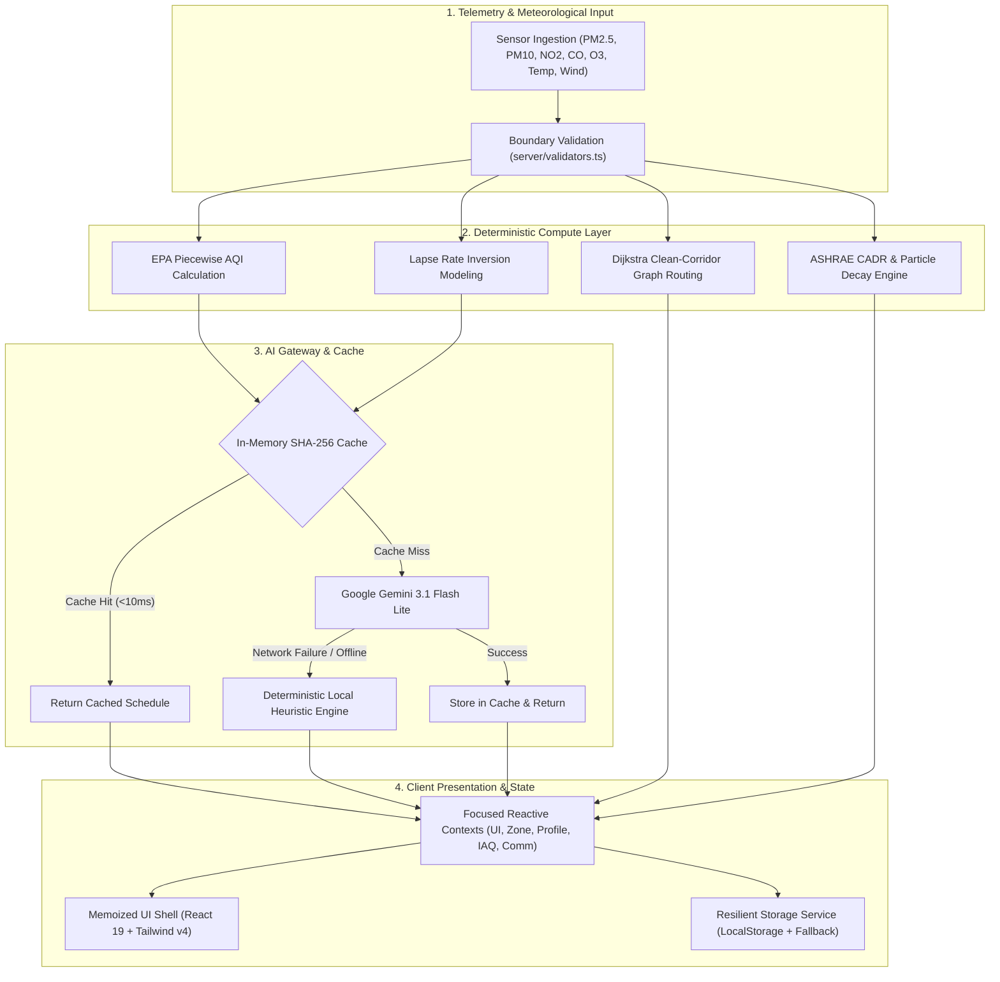

# VAYORA: AI-Powered Urban Air Quality & Environmental Intelligence Platform

> **"Air. Awareness. Action."**  
> An advanced environmental resilience system engineered to protect metropolitan communities and vulnerable populations from winter smog inversions, toxic particulate exposure, and urban atmospheric stagnation.

---

## 1. Project Introduction

**VAYORA** is an independent, full-stack environmental intelligence platform designed for urban centers grappling with hazardous air pollution. Traditional weather applications typically deliver static, citywide Air Quality Index (AQI) figures that fail to reflect neighborhood-level variations, overlook the physics of nocturnal temperature inversions, and offer generic advice without actionable mitigation pathways.

VAYORA addresses this critical gap through a modern, responsive web application that unites:
- **Hyperlocal Telemetry:** Multi-pollutant tracking ($\text{PM}_{2.5}$, $\text{PM}_{10}$, $\text{NO}_2$, $\text{CO}$, $\text{O}_3$) across municipal sectors.
- **Atmospheric Physics Modeling:** Detection of thermal boundary layer inversions that trap particulate matter in the ground-level breathing zone.
- **Personalized Routine Optimization:** Generative AI schedules (powered by Google Gemini with deterministic local heuristic fallbacks) tailored to individual vulnerability profiles.
- **Clean-Corridor Transit Routing:** Dijkstra graph pathfinding to identify subterranean metro links and low-exposure transit alternatives.
- **Indoor Air Quality (IAQ) Engineering:** ASHRAE-aligned Clean Air Delivery Rate (CADR) calculations, window flush schedules, and open-source Corsi-Rosenthal DIY purification designs.
- **Community Action Hub:** Collective neighborhood pledges that quantify real-time carbon ($\text{kg}$) and particulate ($\text{g}$) abatement.

---

## 2. The Urban Air Pollution Problem

High-density urban areas worldwide face recurring seasonal air quality crises. The core drivers of this public health emergency include:

1. **Thermal Inversion Boundary Caps:** During cold winter nights, rapid terrestrial radiative cooling produces a temperature inversion where cold, dense surface air is capped by warmer air aloft. When wind speeds drop below 6 km/h, vertical convective mixing ceases, trapping vehicular exhaust, industrial soot, and secondary aerosols near the ground.
2. **Deep Pulmonary Deposition:** Fine particulates ($\text{PM}_{2.5}$) bypass upper airway filtration and penetrate deep into alveolar capillaries, causing systemic inflammation, acute asthmatic exacerbations, and elevated cardiovascular risks.
3. **The Commuter Exposure Trap:** Urban commuters and outdoor workers frequently exercise or travel during peak morning stagnation windows, unknowingly inhaling toxic pollutant doses in traffic corridors.
4. **Economic Barriers to Clean Indoor Air:** Commercial HEPA air purifiers often cost hundreds of dollars, placing them out of reach for lower-income households. Furthermore, opening windows during morning inversion peaks increases indoor pollutant levels by over 300%.

---

## 3. VAYORA's Proposed Solution

VAYORA translates complex environmental science into accessible, real-time civic intelligence:

```
┌────────────────────────────────────────────────────────────────────────┐
│                        VAYORA SOLUTION MATRIX                          │
├────────────────────────────────┬───────────────────────────────────────┤
│ Atmospheric Inversion Traps    │ ➔ Real-time lapse-rate inversion model │
│ Personalized Health Risk       │ ➔ 6 vulnerability persona profiles    │
│ Hazardous Transit Exposure     │ ➔ Dijkstra low-exposure route finder  │
│ Costly Air Purification        │ ➔ Open-source DIY Corsi-Rosenthal box │
│ Stale Indoor Air Accumulation  │ ➔ Solar-flush window opening schedule │
│ Fragmented Community Response  │ ➔ Collective neighborhood pacts       │
└────────────────────────────────┴───────────────────────────────────────┘
```

---

## 4. Target Users

- **Vulnerable Households:** Families with infants, asthmatic children, and elderly relatives who require precise guidance on safe outdoor windows and indoor air filtration.
- **Urban Commuters:** Daily transit riders, pedestrians, and cyclists seeking the lowest-pollution routes through city street canyons.
- **Community Coordinators & School Boards:** Local neighborhood leaders and school administrators responsible for broadcasting emergency smog advisories and organizing collective emissions reduction initiatives.
- **Environmentally Conscious Citizens:** Individuals committed to tracking and reducing their personal commute footprint and local particulate contribution.

---

## 5. Main Application Capabilities

### 5.1 Airscape: Hyperlocal Telemetry Dashboard
The **Airscape** module provides a real-time, multi-dimensional view of metropolitan atmospheric conditions:
- **Area Explorer:** Instant sector switching across 5 distinct municipal zones:
  1. **Central Business District** (Heavy commercial and fleet traffic density)
  2. **North Industrial Belt** (Manufacturing and point-source particulate emissions)
  3. **Eastern Residential** (High-density housing and localized biomass heating)
  4. **Riverside Park & Wetlands** (Eco-corridor with natural vegetation dispersion)
  5. **Transit Hub & Rail Depot** (Multi-modal transit intersection)
- **Sky Conditions:** Real-time atmospheric metrics including temperature lapse rates, boundary layer inversion capping, relative humidity, and wind velocity.
- **Health Guidance:** Actionable, EPA-aligned public health directives tailored to active pollution severity.
- **Atmospheric Outlook:** 7-day predictive photochemical dispersion forecast with day-by-day severity progression.
- **Pollution Landscape:** Native SVG spatial smog heatmap displaying urban dispersion streamlines and hotspot nodes with full screen-reader text twins.
- **Air Quality Trends:** 7-hour multi-parameter pollutant trend vectors tracking $\text{PM}_{2.5}$, $\text{PM}_{10}$, $\text{NO}_2$, $\text{CO}$, and $\text{O}_3$.
- **Personal Exposure:** Bidirectional hourly exposure report contrasting solar ventilation windows with ground-level smog stagnation periods.
- **Environmental Progress:** Interactive real-time simulation controls ("Simulate Winter Smog Spike" and "Simulate Solar Wind Cleansing").

### 5.2 My Day: GenAI Daily Routine & Exposure Optimizer
The **My Day** module synthesizes personalized, hour-by-hour exposure mitigation schedules:
- Six lifestyle vulnerability personas:
  - *Asthmatic Child & Family* (High respiratory sensitivity)
  - *Newborn Infant & Nursing Mother* (Critical indoor filtration focus)
  - *Elderly Relative (Cardiopulmonary)* (Restricted outdoor exertion)
  - *School Run Coordinator* (Morning commute exposure avoidance)
  - *Daily Transit Commuter* (Multi-modal route optimization)
  - *Community Action Lead* (Neighborhood emissions advocate)
- Server-side Google Gemini 3.1 Flash Lite synthesis generating hour-by-hour schedules.
- Deterministic local heuristic calculation engine providing 100% offline uptime.
- Identification of the optimal outdoor activity window (typically 1:00 PM – 4:00 PM) when solar radiation breaks the inversion cap.

### 5.3 Greener Routes: Low-Emission Commute & Transit Planner
The **Greener Routes** module guides urban commuters through cleaner transit paths:
- Graph-based Dijkstra pathfinding across urban waypoints to identify lowest-exposure trajectories.
- Multi-modal comparison matrix evaluating 7 transit modes:
  - **Underground Metro** (75% cabin filtration protection)
  - **Electric City Bus** (Low local emissions)
  - **Diesel Transit Bus** (High surface street canyon exposure)
  - **Bicycle / E-Bike** (High breathing ventilation rate: 2.2 m³/h)
  - **Walking Pedestrian** (Exertion rate: 1.2 m³/h)
  - **Electric Vehicle with HEPA** (85% sealed cabin protection)
  - **Gasoline Car** (Elevated $\text{NO}_2$ contribution)
- Dynamic calculation of inhaled particulate dose ($\mu\text{g}$) and $\text{CO}_2$ emissions ($\text{kg}$).

### 5.4 Home Air Lab: Indoor Air Quality (IAQ) & CADR Center
The **Home Air Lab** translates indoor air quality physics into practical household solutions:
- Room-by-room Clean Air Delivery Rate (CADR) sizing calculator targeting 4 to 5 Air Changes per Hour (ACH).
- First-order differential decay modeling for 80% indoor air clearance duration.
- Detection of CADR deficits with contextual recommendations.
- Meteorological window ventilation schedule warning against morning inversion ventilation (6:00 AM – 10:30 AM) and advising afternoon solar flush windows (1:30 PM – 3:30 PM).
- Open-source fabrication blueprints for the DIY Corsi-Rosenthal Box ($40 build producing ~350 m³/h CADR).

### 5.5 Collective Impact: Community Action & Smog Abatement Hub
The **Collective Impact** hub coordinates neighborhood-level civic action:
- Neighborhood emission reduction pledges across 5 categories: carpooling, clean heating, dust wet-sweeping, clean waste management, and vulnerable neighbor wellness check-ins.
- Live collective impact calculator aggregating total $\text{CO}_2$ ($\text{kg}$) and $\text{PM}_{2.5}$ ($\text{g}$) averted.
- Automated multilingual emergency smog advisories generated in English, Hindi, Arabic (with native RTL layout), and Spanish.

---

## 6. How the Application Works



---

## 7. System Architecture

VAYORA is structured as a decoupled, multi-tiered architecture:

```
┌────────────────────────────────────────────────────────────────────────┐
│                        CLIENT LAYER (Browser)                          │
│                                                                        │
│   ┌────────────────────────────────────────────────────────────────┐   │
│   │                 AppShell (React 19 + TypeScript)               │   │
│   │    Focused Context Providers (UI, Zone, Profile, IAQ, Comm)    │   │
│   └────────────────────────────────────────────────────────────────┘   │
│                 │                                  │                   │
│                 ▼                                  ▼                   │
│   ┌───────────────────────────┐      ┌───────────────────────────┐     │
│   │    Domain Feature Hooks   │      │   Pure Compute Engine     │     │
│   │   (useAirAnalytics,       │ ────►│   (src/lib/compute/*)     │     │
│   │    useExposureRouting)    │      │  • Dijkstra Pathfinding   │     │
│   └───────────────────────────┘      │  • CADR 4 ACH Decay       │     │
│                 │                    │  • Inversion Lapse Rates  │     │
│                 ▼                    │  • EPA Breakpoints        │     │
│   ┌───────────────────────────┐      │  • Inhaled Dose Math      │     │
│   │    Modular Components     │      │  • Heuristic Routine      │     │
│   │  • AqiGauge               │      └───────────────────────────┘     │
│   │  • SmogHeatmap (SVG)      │                    ▲                   │
│   │  • Sparklines (SVG)       │ ───────────────────┘                   │
│   │  • .sr-only Text Twins    │                                        │
│   └───────────────────────────┘                                        │
└────────────────────────────────────────────────────────────────────────┘
                    │                                    │
           (REST API via proxy)                 (Resilient Persistence)
                    │                                    │
                    ▼                                    ▼
┌───────────────────────────────────────┐    ┌───────────────────────────┐
│        BACKEND LAYER (Node.js)        │    │    PERSISTENT STORAGE     │
│                                       │    │                           │
│   ┌───────────────────────────────┐   │    │  • Browser LocalStorage   │
│   │  Express 5 Security Pipeline  │   │    │  • In-Memory Map Fallback │
│   │  • Helmet (Strict CSP)        │   │    │    (Private/Sandbox mode) │
│   │  • CORS Allowlist             │   │    │  • Resilient safeParse<T> │
│   │  • 15 KB Body Size Cap        │   │    └───────────────────────────┘
│   │  • Rate Limiter (30 req/min)  │   │
│   │  • CWE-209 Error Handler      │   │
│   └───────────────────────────────┘   │
│                   │                   │
│                   ▼                   │
│   ┌───────────────────────────────┐   │
│   │  Type & Range Validators      │   │
│   │  (validateZone, sanitizeText) │   │
│   └───────────────────────────────┘   │
│                   │                   │
│                   ▼                   │
│   ┌───────────────────────────────┐   │
│   │  SHA-256 LRU Cache (100 Max)  │   │
│   └───────────────────────────────┘   │
│                   │                   │
│                   ▼                   │
│   ┌───────────────────────────────┐   │
│   │  Google Gemini 3.1 Flash Lite │   │
│   │  (Server-Side Execution Only) │   │
│   └───────────────────────────────┘   │
└───────────────────────────────────────┘
```

---

## 8. Technology Stack

| Layer | Technology | Version | Purpose |
|---|---|---|---|
| **Frontend Framework** | React | 19.0.0 | Concurrent rendering and modern component lifecycle |
| **Language & Typing** | TypeScript | 5.7.3 | Strict compilation, zero `any` policy |
| **Bundler & Build Tool** | Vite | 6.2.0 | High-performance bundling and sub-second HMR |
| **Styling & Tokens** | Tailwind CSS | 4.0.9 | Nature Meets Urban Intelligence design system |
| **Backend Gateway** | Express | 5.0.1 | REST API, security headers, routing, and asset serving |
| **AI Orchestration** | Google Generative AI | 0.24.1 | Server-side Gemini 3.1 Flash Lite integration |
| **Static Analysis** | Oxlint | 1.94.0 | High-speed linting with zero-warning enforcement |
| **Test Framework** | Vitest + JSDOM | 3.2.7 | Multi-tier unit, DOM, rendering, and API test execution (109 tests) |
| **DOM Testing** | Testing Library | 16.2.0 | User-centric DOM testing and accessibility assertions |

### 8.1 Brand Identity & Design System

- **Brand Personality:** Intelligent, calm, contemporary, trustworthy, and environmentally conscious.
- **Brand Tagline:** *"Air. Awareness. Action."*
- **Visual Identity & Logo:**
  - Abstract geometric symbol (`VayoraSymbol`) inspired by fluid atmospheric streamline motion and micro-current dynamics.
  - Paired with the modern `VAYORA` wordmark.
  - Strictly avoids generic tropes: zero leaves, clouds, shields, purple gradients, emoji icons, or standard AI badges.
  - Standalone symbol favicon (`favicon.svg`) designed for multi-resolution browser tabs.
- **Typography Architecture:**
  - **Headings & Display:** `Space Grotesk` (weights 600, 700, 900) providing modern geometric clarity.
  - **Body & Controls:** `DM Sans` (weights 400, 500, 700) engineered for high-density reading comfort.
  - **Telemetry & Metrics:** `IBM Plex Mono` (weights 500, 700) for fixed-width numerical readouts and tabular figures.
- **Color Token Hierarchy:**
  - **Deep Botanical Greens:** `#11322B`, `#153C35`, `#1E4E45` (navigation, key headings, primary buttons).
  - **Eucalyptus & Mint Highlights:** `#3FB4A5`, `#398F83`, `#EBF2EC` (live badges, focus states, accents).
  - **Warm Stone Canvas:** `#F7F8F4`, `#F6F7F2` (glare-free neutral background surfaces).

---

## 9. Project Directory Structure

```text
vayora/
├── .github/
│   └── workflows/
│       └── ci.yml               # GitHub Actions CI pipeline (Node.js 20 from .nvmrc)
├── docs/
│   ├── CODE_QUALITY_REPORT.md   # Architectural line-limit & linter audit
│   ├── DECISIONS.md             # Architecture Decision Records (ADR 001–009)
│   └── PLAN.md                  # Engineering specifications and roadmap
├── server/
│   ├── routes/
│   │   ├── adminRoutes.ts       # Protected admin diagnostic and cache purge routes
│   │   ├── advisoryRoutes.ts    # Emergency smog advisory route handler
│   │   ├── healthRoutes.ts      # Health check and telemetry status route
│   │   └── routineRoutes.ts     # Personalized routine insight route handler
│   ├── aiService.ts             # Gemini AI integration with heuristic fallback
│   ├── auth.ts                  # PBKDF2/SHA-512 authentication & constant-time verify
│   ├── cache.ts                 # In-memory SHA-256 LRU response cache (100 entries)
│   ├── cacheOrCompute.ts        # Unified validation, caching, and AI orchestration
│   ├── logger.ts                # Structured server logging utility
│   ├── middleware.ts            # Helmet CSP, dynamic CORS, rate limiting, error handlers
│   └── validators.ts            # Runtime type guards and input sanitizers
├── src/
│   ├── components/
│   │   ├── Community/
│   │   │   ├── CommunityHub.tsx # Pledges, offset counters, emergency broadcasts
│   │   │   └── PledgeCard.tsx   # Action cards with participation progress bars
│   │   ├── Dashboard/
│   │   │   ├── AirTelemetryDashboard.tsx # Hyperlocal overview & sector cards
│   │   │   ├── AqiGauge.tsx     # Prominent circular SVG AQI gauge
│   │   │   ├── PollutantSparklinesPanel.tsx # 7-hour multi-pollutant vectors
│   │   │   └── SmogHeatmap.tsx  # Native SVG spatial dispersion grid
│   │   ├── IAQ/
│   │   │   ├── DIYHackGrid.tsx  # Corsi-Rosenthal & low-cost filtration designs
│   │   │   ├── IAQCenter.tsx    # Room CADR calculator & 4 ACH sizing
│   │   │   └── WindowSchedule.tsx # Inversion-aware window opening timetable
│   │   ├── Legal/
│   │   │   └── LegalModal.tsx   # Privacy Policy & Terms of Service dialog
│   │   ├── Navigation/
│   │   │   ├── Header.tsx       # Desktop sidebar & mobile navigation with chunk preloading
│   │   │   ├── NavControls.tsx  # Language & accessibility mode switchers
│   │   │   └── SidebarSectorCard.tsx # Quick-switch sector widget
│   │   ├── Routine/
│   │   │   ├── DailyRoutineOptimizer.tsx # GenAI daily schedule container with AbortSignal
│   │   │   ├── PersonaSelector.tsx # Vulnerability profile selection chips
│   │   │   └── RoutineTimeline.tsx # Hour-by-hour exposure schedule
│   │   ├── shared/
│   │   │   ├── AlertBanner.tsx  # Assertive emergency smog notification banner
│   │   │   ├── Icons.tsx        # Custom accessible SVG iconography (zero emojis)
│   │   │   ├── Sparkline.tsx    # Native SVG sparkline with sr-only twin
│   │   │   ├── VayoraLogo.tsx   # Atmospheric airflow symbol and brand wordmark
│   │   │   └── ZoneCard.tsx     # Urban sector status card
│   │   └── Transit/
│   │       ├── TransitComparisonTable.tsx # Multi-modal health risk table
│   │       └── TransitPlanner.tsx # Dijkstra clean-corridor route planner
│   ├── context/
│   │   ├── hooks/               # Domain-specific typed hooks (useUIContext, etc.)
│   │   ├── providers/           # Focused domain providers (UIProvider, ZoneProvider, etc.)
│   │   ├── AppContext.tsx       # Root composition provider uniting all domain contexts
│   │   ├── appContextInstance.ts # Shared React Context instance definition
│   │   ├── contextInstances.ts  # Domain React Context instance definitions
│   │   ├── types.ts             # Domain state and action interface definitions
│   │   └── useAppContext.ts     # Backward-compatible unified state access hook
│   ├── hooks/
│   │   ├── useAirAnalytics.ts   # AQI categories, pollutant breakdown, simulation
│   │   ├── useDebounce.ts       # Debounced callback execution with unmount cleanup
│   │   └── useExposureRouting.ts # Dijkstra pathfinding & commute comparisons
│   ├── lib/
│   │   ├── compute/
│   │   │   ├── aqiBreakpoints.ts # EPA category mapping & health directives
│   │   │   ├── aqiPollutantsCompute.ts # Pollutant breakdown and inversion telemetry
│   │   │   ├── asserts.ts       # Numeric type assertions & linear interpolation
│   │   │   ├── cadrCalculations.ts # Volume, CADR sizing, first-order decay
│   │   │   ├── commuteDose.ts   # Inhaled particulate dose & transit metrics
│   │   │   ├── dijkstraRouter.ts # Lowest-exposure shortest path algorithm
│   │   │   ├── heuristicRoutine.ts # Client deterministic fallback schedule generator
│   │   │   ├── index.ts         # Compute engine barrel export
│   │   │   └── meteorology.ts   # Lapse-rate inversion modeling & emission offsets
│   │   ├── constants/
│   │   │   ├── community.ts     # Baseline nodes, graphs, pledges, alerts
│   │   │   ├── iaq.ts           # Room baselines & DIY hack specifications
│   │   │   ├── index.ts         # Constants barrel export
│   │   │   ├── personas.ts      # Vulnerability profile definitions
│   │   │   ├── translations.ts  # Multilingual strings (EN, HI, AR, ES)
│   │   │   └── zones.ts         # Municipal telemetry baseline sectors
│   │   └── tabPreload.ts        # Intent-driven dynamic route chunk preloader
│   ├── services/
│   │   ├── apiService.ts        # Client HTTP API client with AbortSignal cancellation
│   │   └── storageService.ts    # Resilient persistence with memory store fallback
│   ├── test/
│   │   ├── adminAuth.test.ts    # Tier 5: Authentication, token verification, admin endpoints
│   │   ├── api.test.ts          # Tier 5: Live backend HTTP, security & cache tests
│   │   ├── aqiBreakpoints.test.ts # Tier 1: EPA breakpoint & sub-index calculations
│   │   ├── aqiCommute.test.ts   # Tier 1: Exposure dose & transit metrics
│   │   ├── aqiIaq.test.ts       # Tier 1: CADR calculations & particle decay
│   │   ├── dom.test.tsx         # Tier 4: User events, simulations, selectors, pledges
│   │   ├── rendering.test.tsx   # Tier 3: Landmarks & screen-reader twin readouts
│   │   ├── routineStorage.test.ts # Tier 1: Heuristic routines & storage persistence
│   │   ├── routing.test.ts      # Tier 2: Dijkstra pathfinding & hook transitions
│   │   ├── serverAndCompute.test.ts # Tier 1: Cache, logger, and pure pollutant compute
│   │   ├── serverPerformanceHeaders.test.ts # Tier 5: Compression, ETag, static caching
│   │   └── setup.ts             # Vitest DOM polyfills & matchers
│   ├── types/
│   │   ├── community.ts         # Waypoints, room configs, community pledges
│   │   ├── index.ts             # Primary types barrel export
│   │   ├── routine.ts           # Personas, hourly schedule, routine plan
│   │   └── telemetry.ts         # AQI categories, pollutants, transit modes, zones
│   ├── App.tsx                  # AppShell router, lazy route chunks, accessible fallback
│   ├── index.css                # CSS design tokens & focus-visible styles
│   ├── main.tsx                 # React 19 application entry point
│   └── vite-env.d.ts            # Vite client environment type declarations
├── .nvmrc                       # Node runtime pin (v20)
├── .oxlintrc.json               # Oxlint static analysis configuration (152 rules)
├── index.html                   # HTML template, font preconnects, swap display
├── package.json                 # Dependencies, project metadata, scripts
├── server.ts                    # Express 5 entry point, routes, static asset hosting
├── tsconfig.json                # Strict TypeScript configuration
├── tsconfig.test.json           # Test TypeScript configuration (Vite & Node types)
└── vite.config.ts               # Vite build configuration, proxy, manual chunk splitting
```

---

## 10. Installation Instructions

### Prerequisites
- **Node.js:** v20.x or newer (tested on Node v22 and v26)
- **Package Manager:** npm v10.x or higher

### Step-by-Step Setup
```bash
# 1. Clone the repository
git clone https://github.com/[user]/vayora.git
cd vayora

# 2. Install dependencies
npm install

# 3. Create your environment configuration file
cp .env.example .env
```

---

## 11. Environment Configuration

Inspect the `.env.example` file to configure your local environment variables:

| Variable | Required | Default | Purpose |
|---|---|---|---|
| `PORT` | No | `3001` | Port on which the Express backend gateway listens |
| `GEMINI_API_KEY` | Optional | `""` | Google Gemini API key for live AI synthesis. If left empty, VAYORA seamlessly operates in offline mode using its built-in deterministic heuristic engine. |
| `VITE_API_BASE_URL` | No | `""` | Base URL for API requests. In development, Vite automatically proxies `/api` calls to port `3001`. |

---

## 12. Development Instructions

VAYORA can be run in two modes:

### Full-Stack Mode (Frontend + Express Backend)
```bash
# Terminal 1: Start backend API server (Port 3001)
npm run server:dev

# Terminal 2: Start frontend Vite development server (Port 5173)
npm run dev
```
Open `http://localhost:5173` in your browser.

### Standalone Production Build Mode
```bash
# Compile TypeScript and build production assets
npm run build

# Start the Node.js production server (serves API and compiled SPA)
npm run server
```
Access the application at `http://localhost:3001`.

---

## 13. Testing and Verification

VAYORA maintains a multi-tier test suite executed via Vitest and Oxlint:

```bash
# Run all 109 automated unit, DOM, rendering, and API tests
npm run test:run

# Run test suite with strict coverage enforcement
npm run test:coverage

# Run static code analysis with zero-warning enforcement
npm run lint

# Compile production bundle with strict TypeScript validation
npm run build
```

### Verified Test Results Summary
- **Test Suites:** 11 passed (11 total)
- **Tests:** 109 passed (109 total)
- **Execution Time:** ~5.1 seconds
- **Pass Rate:** 100%

---

## 14. Security Considerations

VAYORA implements a Zero-Trust defense-in-depth security model:
1. **Server-Side Credential Custody:** The `GEMINI_API_KEY` is strictly confined to the backend server runtime (`server.ts`). It is never bundled into client-side code, never exposed via `VITE_` variables, and never visible in browser network tabs.
2. **Strict Content Security Policy (CSP):** Delivered via Helmet with restrictive directives preventing unauthorized external script execution.
3. **Payload Size Capping:** Express body parsing is strictly capped at `15kb` (`express.json({ limit: '15kb' })`), mitigating Denial-of-Service and buffer overflow attacks.
4. **Input Sanitization:** Strips non-printable ASCII control characters (`\x00`–`\x1f`) and enforces numeric boundary checks.
5. **Rate Limiting:** Protects AI synthesis endpoints at 30 requests per minute per IP.
6. **CWE-209 Information Disclosure Mitigation:** Global error middleware catches backend exceptions, logs details server-side, and returns a safe, generic message (`{ error: 'Internal Server Error' }`).

---

## 15. Accessibility Implementation

Engineered to fully satisfy **WCAG 2.2 Level AA** standards:
- **Twin Representation Rule (SC 1.1.1):** All visual graphics (Smog Heatmap, Pollutant Sparklines) are paired with adjacent, screen-reader-only (`.sr-only`) structured text twins providing equivalent analytical information.
- **Semantic HTML5 Landmarks:** The DOM tree is mapped to standard landmarks: `<header>`, `<nav role="tablist">`, `<main id="main-content" role="tabpanel">`, and `<footer role="contentinfo">`.
- **Keyboard Navigation:** Includes a skip-to-content anchor, visible focus outlines (`:focus-visible`), and roving tab navigation with Arrow key, Home, and End support.
- **Multilingual Bidirectional Support:** Supports English, Hindi, Spanish, and Arabic with automatic right-to-left (`dir="rtl"`) layout switching.
- **Color Independence:** Air quality severity is never communicated via color alone; each level includes explicit text labels, numerical values, and icons.

---

## 16. Known Limitations

1. **Synthetic Telemetry Baseline:** While the application is designed to ingest live environmental JSON feeds, the default deployment runs on realistic simulated baseline data representing typical urban smog sectors until municipal IoT hardware is connected.
2. **Single-Compartment Air Exchange Model:** The CADR room calculator utilizes standard ASHRAE first-order decay equations assuming well-mixed indoor air; real-world infiltration rates may vary with building envelope sealing quality.
3. **External Gemini Rate Quotas:** When running with an active Gemini API key on Google Cloud's free tier, high-frequency requests may encounter rate limits; VAYORA mitigates this with its in-memory SHA-256 LRU cache and automatic fallback to local heuristic routines.

---

## 17. Future Development Opportunities

- **Hardware IoT Integration:** Direct Bluetooth Low Energy (BLE) and MQTT connectivity with affordable home air quality monitors (PMS5003 / Sensirion SPS30).
- **Predictive Machine Learning:** Local time-series forecasting for 24-hour smog progression using TensorFlow.js or BigQuery ML.
- **Civic Notification Webhooks:** Automated push notifications and SMS broadcast alerts integrated with municipal emergency management systems.
- **Crowdsourced Hyperlocal Sensing:** Public participation mechanisms allowing residents to contribute calibrated DIY sensor readings to the citywide heatmap.

---

## License

This software is released under the **VAYORA Public License**. See [LICENSE](LICENSE) for details.
