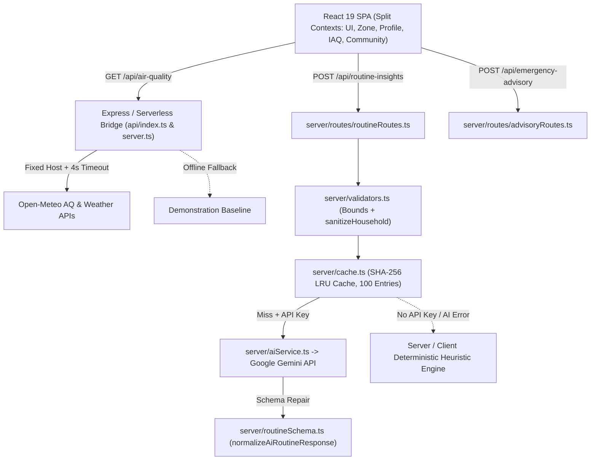

# VAYORA — AI-Powered Urban Air Quality & Environmental Intelligence Platform

> **"Air. Awareness. Action."**  
> An urban environmental resilience assistant built to help families make healthier, lower-emission daily decisions during severe air pollution and winter temperature inversions.

---

## 1. Project Overview

**VAYORA** is a full-stack web application combining hyperlocal air quality telemetry, atmospheric boundary-layer modeling, a household action planner powered by Google Gemini (with a deterministic heuristic fallback), clean-corridor Dijkstra transit routing, indoor Clean Air Delivery Rate (CADR) sizing, and neighborhood resilience tracking.

Instead of leaving residents with raw, citywide AQI numbers, VAYORA turns neighborhood air conditions and household context into a cohesive daily action plan across outdoor timing, indoor air quality, and sustainable mobility.

---

## 2. Problem Being Addressed

Dense urban corridors frequently experience hazardous particulate ($\text{PM}_{2.5}$, $\text{PM}_{10}$) and nitrogen dioxide ($\text{NO}_2$) episodes, worsened by nocturnal cold-weather thermal inversions that trap tailpipe and industrial emissions near street level. Families face three practical barriers:

1. **Generic City Averages vs. Local Decisions:** Citywide AQI scores rarely explain morning stagnation hazards or highlight afternoon solar mixing windows for vulnerable family members.
2. **Lack of Integrated Household Guidance:** Families with infants, asthmatic children, or older adults lack a single plan uniting outdoor scheduling, room ventilation timing, affordable filtration, and safer commute modes.
3. **Opaque Impact & Commercial Cost:** Commercial HEPA units are expensive, while generic advice mixes unverified percentages with actual air measurements.

---

## 3. VAYORA's Solution

VAYORA connects local environmental data directly to household choices while clearly distinguishing **live measurements**, **demonstration baseline data**, and **calculated estimates**:

- **Live Telemetry & Transparent Demo Fallback:** Fetches live neighborhood AQI, $\text{PM}_{2.5}$, $\text{PM}_{10}$, $\text{NO}_2$, $\text{CO}$, $\text{O}_3$, temperature, humidity, and wind velocity via **Open-Meteo** (`/api/air-quality`). When offline or un-synced, the UI explicitly labels **Demonstration Baseline** or **Simulated Scenario** mode.
- **Step-by-Step Household Action Planner (`My Day`):** Captures neighborhood, family composition (children/elders), optional sensitivity notes, commuting habit, outdoor activity, and purifier setup, then synthesizes tailored recommendations with explicit reasoning and effort tags.
- **Indoor Air Engineering (`Home Air Lab`):** Computes room volume ($V$), ASHRAE 4 ACH target CADR, particle decay time, inversion-aware window schedules, and open-source Corsi-Rosenthal DIY box-fan builds.
- **Clean-Corridor Routing (`Greener Routes`):** Uses Dijkstra pathfinding across transit waypoints to surface enclosed subway and greenway links alongside per-mode exposure estimates.
- **Collective Resilience (`Collective Impact`):** Tracks neighborhood pledges and generates multilingual safety broadcasts (EN, HI, AR with RTL, ES).

---

## 4. Main Features

| Module | Key Capabilities | Data / Engine Basis |
|---|---|---|
| **Airscape (Dashboard)** | 5 municipal sectors, EPA circular AQI gauge, native SVG spatial heatmap, 7-hour pollutant sparklines, dynamic outlook card, live Open-Meteo sync & stress simulations | EPA Breakpoints + Meteorology Lapse Engine + Open-Meteo API |
| **My Day (Core Workflow)** | 6 vulnerability personas + editable household context (`HouseholdContextForm.tsx`), structured A/B/C/D priority recommendations, interactive indoor air checklist, sustainable commute snapshot, hourly timeline | Server Gemini Gateway + Runtime Schema Normalizer + Deterministic Heuristic Fallback |
| **Greener Routes (Transit)** | Dijkstra clean-corridor pathfinder bypassing high-smog junctions + 7-mode inhaled dose ($\mu\text{g}$) and $\text{CO}_2$ comparison | `dijkstraRouter.ts` + `commuteDose.ts` |
| **Home Air Lab (IAQ)** | Room-by-room floor area & purifier CADR sliders, 4 ACH target & deficit detector, window schedule, DIY purifier blueprints | `cadrCalculations.ts` + Corsi-Rosenthal public designs |
| **Collective Impact** | Interactive neighborhood emission reduction pledges, aggregate model offsets, emergency broadcasts | `meteorology.ts` + `advisoryRoutes.ts` |

---

## 5. Core User Journey

The primary VAYORA V1 family workflow is accessible directly from the **Need a Family Air Action Plan?** launcher on the Dashboard or via the **My Day** tab:

1. **Understand the Household:** Choose a vulnerability preset (e.g., *Asthmatic Child & Family*, *Elderly Relative*, *Daily Urban Commuter*) and tailor neighborhood, family composition, children/older adult flags, optional sensitivity notes, commute habit, outdoor activity, and indoor purifier status.
2. **Understand Local Air Conditions:** Inspect live Open-Meteo readings (or clearly marked Demonstration Baseline / Simulated Stress-Test telemetry) including AQI, EPA category, $\text{PM}_{2.5}$, wind speed, and boundary-layer inversion status.
3. **Generate Personalized Recommendations:** Click **Generate Smart Schedule**. The backend checks the validated payload cache, calls Google Gemini when `GEMINI_API_KEY` is configured (or executes the deterministic meteorology engine when absent), and validates the JSON shape before returning.
4. **Act on One Cohesive Plan:** Without leaving the screen, review:
   - **Priority Recommendations (A–D):** Low-emission daily routines, indoor air quality actions, sustainable transit choices, and explicit impact explanations (*What to change*, *Why it matters*, *Environmental benefit*, *Exposure note*, *Effort level*, *Estimate tag*).
   - **Interactive Indoor Air Checklist:** Stateful action items tracking completion count.
   - **Sustainable Commute Comparison:** Side-by-side estimated inhaled particulate dose and $\text{CO}_2$ comparing the household's current commute mode against shielded metro transit.
   - **Hourly Exposure Timeline & Transparency Notice:** Hour-by-hour activity classification paired with the active telemetry mode and recommendation source.

---

## 6. Technology Stack

- **Frontend:** React 19 (`19.0.0`), TypeScript (`5.7.3` strict mode), Vite 6 (`6.2.0`), Tailwind CSS v4 (`4.0.9`)
- **Backend:** Express 5 (`5.0.1`), Node.js (`>=20.0.0`), `helmet`, `cors`, `compression`, `express-rate-limit`
- **GenAI SDK:** `@google/generative-ai` (`0.24.1`) targeting configurable Gemini Flash-Lite (`gemini-3.1-flash-lite` default via `GEMINI_MODEL`)
- **Live Data Ingestion:** Open-Meteo Air Quality & Weather Forecast APIs (no API key required; graceful demo fallback)
- **Verification Tooling:** Oxlint (`1.94.0` with 152 rules), Vitest (`3.2.7`), React Testing Library (`16.2.0`), JSDOM (`26.0.0`)

---

## 7. System Architecture



- **State Isolation:** Global state is split across five memoized providers (`UIProvider`, `ZoneProvider`, `ProfileProvider`, `IAQProvider`, `CommunityProvider`) under `src/context/providers/`.
- **Code Splitting:** Heavy viewports (`DailyRoutineOptimizer`, `TransitPlanner`, `IAQCenter`, `CommunityHub`) load lazily via `React.lazy` with intent preloading (`src/lib/tabPreload.ts`).
- **Deployment Parity:** Standalone Node/Express (`server.ts`) serves both `/api/*` and compiled `dist/`, while `api/index.ts` and `vercel.json` expose the same Express app to Vercel serverless routing.

---

## 8. AI Integration & Prompt Design

### Context Supplied to the Model
When generating a plan via `POST /api/routine-insights`, only validated, non-identifying contextual parameters are sent to `buildRoutinePrompt()` in `server/aiService.ts`:
- **Household context:** `householdComposition`, `hasChildren`, `hasElderly`, voluntary sanitized `sensitivities`, `commuteMode`, `outdoorActivity`, `indoorPurifier`.
- **Zone telemetry:** `zoneName`, `aqi`, `pm25`, `windSpeedKmh`, `inversionRisk`.
- **Preferences:** Target persona profile (`name`, `sensitivityLevel`) and sanitized `language` code (`en`, `hi`, `ar`, `es`).

### Structured Output & Safeguards
1. **Prompt Guardrails:** The prompt explicitly instructs Gemini not to invent unverified $\text{CO}_2$ savings percentages or clinical cures and to match strict JSON keys (`optimalOutdoorWindow`, `hourlySchedule`, `priorityRecommendations`, `indoorChecklist`, `commuteSuggestion`, `householdGuidance`, `generalAdvice`).
2. **Schema Normalization (`server/routineSchema.ts`):** `normalizeAiRoutineResponse()` validates arrays, objects, and numeric fields from the LLM output. If Gemini omits any section or returns invalid JSON, deterministic heuristic sections automatically fill the gap so the UI never crashes.
3. **Zero-Downtime Fallback:** If `GEMINI_API_KEY` is unset, quota-limited, or the browser is offline, the server heuristic (`server-heuristic`) or browser engine (`client-offline-heuristic`) builds a structured plan directly from EPA AQI categories and ASHRAE/meteorology formulas.
4. **Prompt Injection & Secret Protection:** Inputs are sanitized via `sanitizeText()` (stripping ASCII control chars `\x00–\x1f`, stripping HTML tags, and bounding string lengths). `GEMINI_API_KEY` never enters `VITE_*` variables or frontend code.

---

## 9. Data Flow

1. **Telemetry Hydration:** `useAirAnalytics` requests `/api/air-quality?zoneId=...&lat=...&lng=...` in browser sessions. `server/airQualityService.ts` fetches Open-Meteo pollutant & weather variables, converts $\text{NO}_2$/$\text{CO}$/$\text{O}_3$ units, and tags `source: 'open-meteo-live'`. On failure, `source` switches cleanly to `'demonstration-baseline'`.
2. **Local Persistence:** Household profile, selected zone, rooms, pledges, language, and accessibility mode persist safely via `src/services/storageService.ts` (`safeParse<T>()` + in-memory `Map` fallback).
3. **Action Plan Lifecycle:** `DailyRoutineOptimizer.tsx` dispatches an `AbortSignal`-backed request to `/api/routine-insights`, hashing zone telemetry + sanitized household context for 100-entry SHA-256 LRU caching.

---

## 10. Project Directory Structure

```text
vayora/
├── .github/workflows/ci.yml             # CI pipeline: lint, typecheck, tests, coverage, build
├── api/index.ts                         # Vercel serverless bridge for Express /api routes
├── docs/                                # Engineering plan, ADRs, and code quality report
│   ├── CODE_QUALITY_REPORT.md
│   ├── DECISIONS.md
│   └── PLAN.md
├── public/                              # SVG favicon, robots.txt, site.webmanifest
├── scripts/                             # verify-doc-files.mjs, generate-code-quality-metrics.mjs, analyze-bundle.mjs
├── server/
│   ├── routes/                          # healthRoutes.ts, airQualityRoutes.ts, routineRoutes.ts, advisoryRoutes.ts, adminRoutes.ts
│   ├── aiService.ts                     # Gemini client + prompt builder + fallback delegation
│   ├── airQualityService.ts             # Open-Meteo AQ + Weather client & fallback
│   ├── auth.ts                          # PBKDF2/SHA-512 hashing & admin bearer middleware
│   ├── cache.ts & cacheOrCompute.ts     # 100-entry SHA-256 LRU cache orchestrator
│   ├── logger.ts & middleware.ts        # Helmet CSP, CORS allowlist, rate limiters, error handler
│   ├── routineSchema.ts                 # Household recommendation builders & AI JSON normalizer
│   └── validators.ts                    # Structural guards, bounds & household sanitizers
├── src/
│   ├── components/                      # Memoized React views (Dashboard, Routine, Transit, IAQ, Community, Navigation, Legal, shared)
│   ├── context/                         # Split UI, Zone, Profile, IAQ, Community providers & hooks
│   ├── hooks/                           # useAirAnalytics.ts, useExposureRouting.ts, useDebounce.ts
│   ├── lib/compute/                     # Pure math: EPA breakpoints, meteorology, CADR, commuteDose, Dijkstra, heuristicRoutine, routineAdvice
│   ├── lib/constants/                   # Municipal baselines, personas/household defaults, DIY specs, translations
│   ├── services/                        # apiService.ts & storageService.ts
│   ├── test/                            # 14 automated Vitest suites (119 tests)
│   └── types/                           # Strictly typed interfaces & discriminated unions
├── server.ts                            # Express 5 entrypoint & static dist server
├── vercel.json                          # Vercel SPA + /api rewrite & security header rules
└── vite.config.ts                       # Vite 6 bundler, dev /api proxy & Vitest coverage config
```

---

## 11. Installation & Environment Configuration

### Prerequisites
- **Node.js:** `>= 20.0.0` (see `.nvmrc`)
- **npm:** `>= 10.0.0`

### Setup
```bash
git clone https://github.com/24a31a05fx/VAYORA.git
cd VAYORA
npm install
cp .env.example .env
```

### Environment Variables (`.env`)
| Variable | Required | Default | Purpose |
|---|---|---|---|
| `GEMINI_API_KEY` | Optional | `""` | Server-side Google Gemini API key. When omitted, server deterministic models handle routine and advisory generation automatically. |
| `GEMINI_MODEL` | No | `gemini-3.1-flash-lite` | Override Gemini model ID for future upgrades without code edits. |
| `PORT` | No | `3001` | Port bound by `server.ts` in standalone server mode. |
| `NODE_ENV` | No | `development` | Runtime mode (`development`, `production`, `test`). |
| `ADMIN_SECRET_KEY` | Production | Default dev key | Bearer / `x-admin-key` secret guarding `/api/admin/*` diagnostic endpoints. |
| `VITE_API_BASE_URL` | No | `""` | Optional external backend origin; leave blank when Vite proxies `/api` or Express serves the SPA directly. |

---

## 12. Local Development Commands

```bash
# 1. Start full-stack dev servers (run in two terminals)
npm run server:dev   # Express API gateway on http://localhost:3001
npm run dev          # Vite React dev server on http://localhost:5173 (proxies /api -> 3001)

# 2. Build and run standalone full-stack production server
npm run build
npm run server       # Serves compiled dist/ + /api/* on http://localhost:3001
```

---

## 13. Testing & Verification

```bash
npm run lint           # Oxlint (--deny-warnings across 152 rules, <= 200 lines/file, <= 25 lines/fn)
npm run typecheck      # Strict tsc -b && tsc -p tsconfig.test.json --noEmit
npm run test:run       # Run all 14 Vitest suites (119 automated tests)
npm run test:coverage  # Enforce coverage thresholds (>=80% lines/functions, >=70% branches)
npm run verify         # Execute full lint + typecheck + test + build gate
```

---

## 14. Deployment Instructions

VAYORA is pre-configured for two clean deployment paths:

### Option A: Single-Service Node Host (Render, Railway, Fly.io, Cloud Run)
1. Set environment variables (`GEMINI_API_KEY`, `ADMIN_SECRET_KEY`, `NODE_ENV=production`).
2. Build Command: `npm ci && npm run build`
3. Start Command: `npm run server`
Express serves `/api/*` endpoints and static `dist/` SPA assets from a single origin with compression, Helmet CSP, and ETag caching.

### Option B: Vercel (Static SPA + `/api` Serverless Bridge)
1. [vercel.json](vercel.json) compiles `dist/` via `npm run build`, sets immutable `/assets/*` cache headers and HTTP security headers, and routes `/api/(.*)` to [api/index.ts](api/index.ts).
2. Configure `GEMINI_API_KEY` and `ADMIN_SECRET_KEY` in Vercel Project Settings -> Environment Variables (never prefix server secrets with `VITE_`).

---

## 15. Security Considerations & Six Challenge Parameters

VAYORA preserves all six architectural verification parameters:
1. **Problem Statement Alignment ([PROBLEM_ALIGNMENT.md](PROBLEM_ALIGNMENT.md)):** End-to-end household context, local telemetry, routines, IAQ engineering, transit routing, and community action.
2. **Accessibility ([ACCESSIBILITY.md](ACCESSIBILITY.md)):** WCAG 2.2 AA landmarks, skip links, roving tab focus, `.sr-only` twins on SVGs/charts, multilingual RTL Arabic support, high-contrast & reduced-motion modes.
3. **Efficiency ([EFFICIENCY.md](EFFICIENCY.md)):** Native SVG graphics (zero heavy chart libraries), route-level `React.lazy`, hover preloading, and SHA-256 LRU caching.
4. **Code Quality ([CODE_QUALITY.md](CODE_QUALITY.md)):** Every source file strictly $\le 200$ lines, functions $\le 25$ lines, cyclomatic complexity $\le 10$, zero `any`, zero warnings.
5. **Security ([SECURITY.md](SECURITY.md)):** Server-side `GEMINI_API_KEY` custody, Helmet CSP, CORS allowlist, 15 KB JSON cap, endpoint rate limiters, PBKDF2 + `timingSafeEqual` admin auth, input bounds, HTML/control-char sanitization, CWE-209 safe errors, and fixed-host SSRF-safe Open-Meteo fetches.
6. **Testing ([TESTING.md](TESTING.md)):** 5-tier automated verification harness across unit math, routing hooks, rendering/a11y twins, end-to-end household workflows, and live Express HTTP endpoints.

---

## 16. Known Limitations

1. **Simulated Municipal Sectors Fallback:** By default, the five municipal neighborhoods anchor to latitude/longitude coordinates around an urban grid (`DEFAULT_ZONES` in `src/lib/constants/zones.ts`). Selecting **Fetch Live Open-Meteo** updates active zone metrics with live regional Open-Meteo model/station observations; if offline or rate-limited, VAYORA explicitly falls back to **Demonstration Baseline** mode.
2. **Modelled Estimates:** Commute $\text{CO}_2$ differentials, inhaled particulate exposure scores, single-compartment 4 ACH CADR clearance times, and 6-day outlook curves are mathematical/educational models derived from public EPA/ASHRAE/transport formulas rather than personal medical diagnostics or metered emissions.
3. **Optional Live AI Key:** Without a configured server `GEMINI_API_KEY`, recommendations run transparently through the deterministic heuristic engine rather than generative LLM inference.

---

## Third-Party Attributions & License

- **Air Quality Breakpoints:** U.S. Environmental Protection Agency (EPA) AQI particulate breakpoints.
- **Indoor Filtration Calculations:** ASHRAE dilution / clean air delivery rate equations and public-domain **Corsi-Rosenthal Box** design patterns.
- **Live Environmental Data:** **Open-Meteo** Air Quality and Weather APIs.
- **Generative AI:** **Google Gemini API** via official `@google/generative-ai` SDK.
- **Software License:** Released under the **VAYORA Public License**. See [LICENSE](LICENSE).
